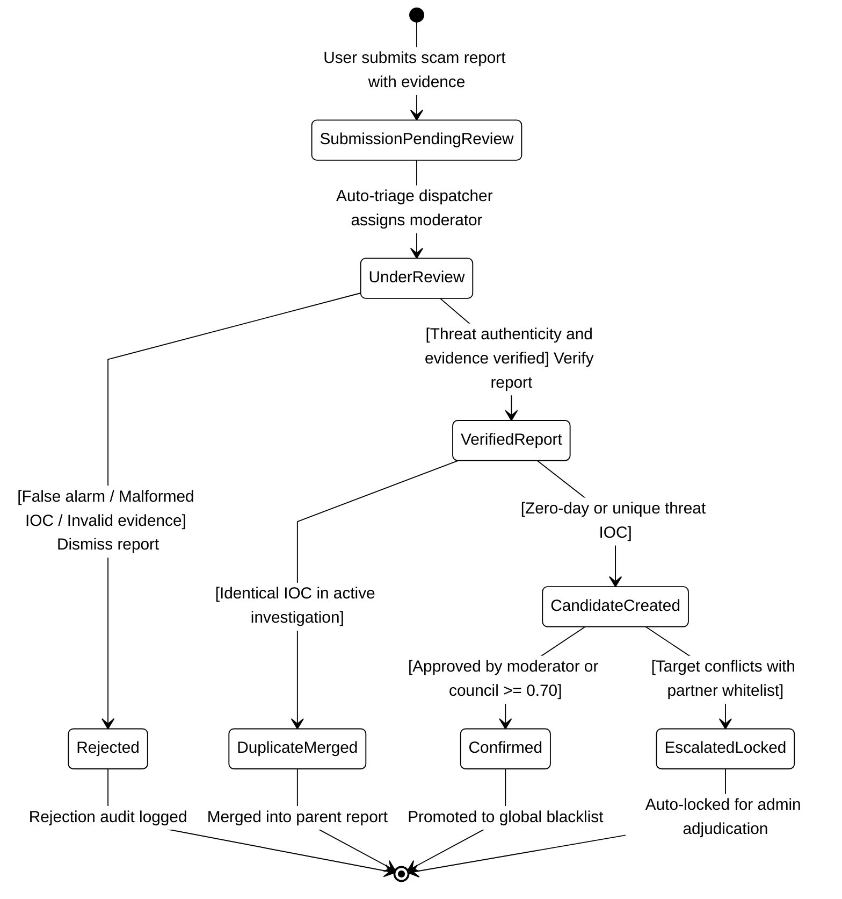
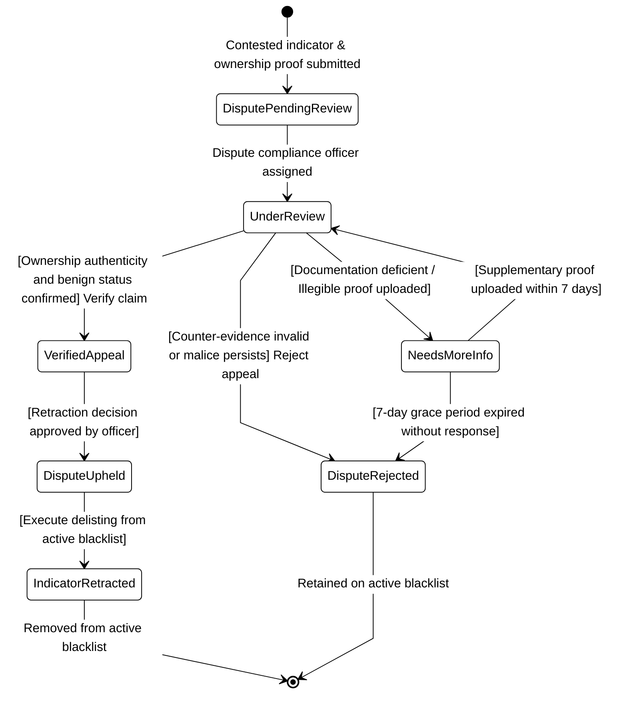
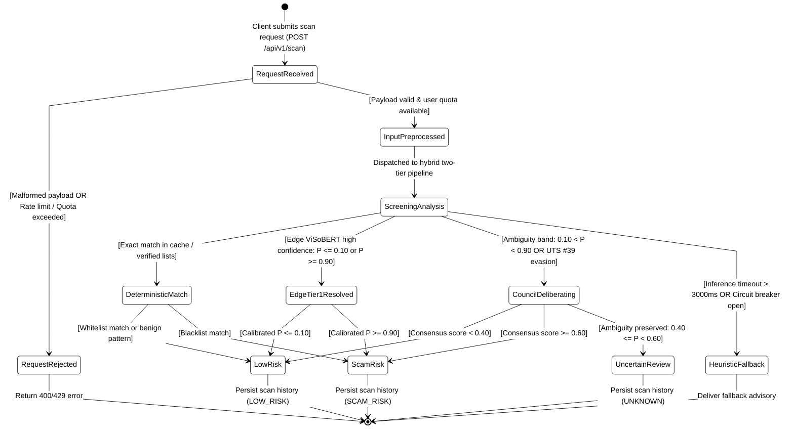
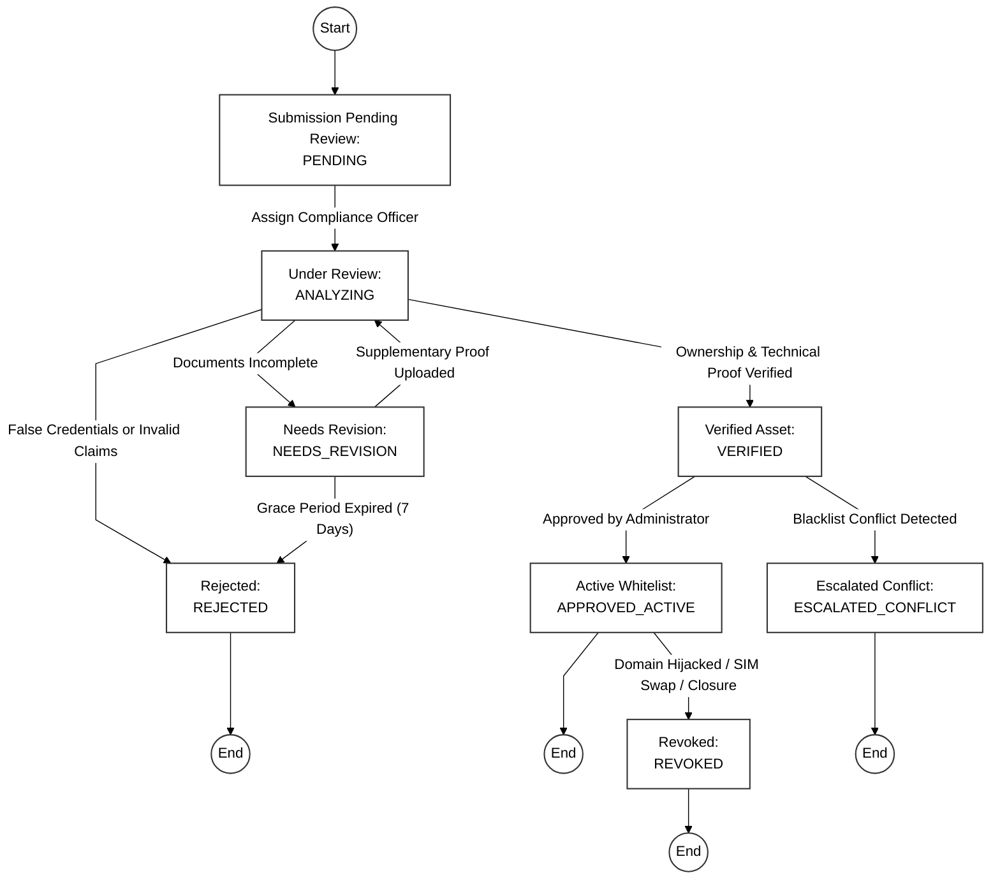
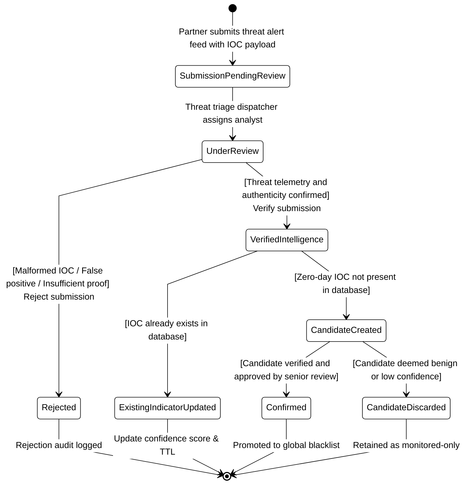

# 08. UML STATE MACHINE DIAGRAMS — SEP REPORT 4
## SCAMSHIELD-VN: ARCHITECTURAL STATE MODELING

**Sprint:** SCRUM Sprint 2  
**Epic:** [SCRUM-40] Docs  
**Assignee:** Hiếu Nguyễn Trung  
**Reference Deliverable:** Report 4 - Google Tài liệu (FA26SE079 Software Engineering Project)  
**Standard Compliance:** OMG UML 2.5 Specification & JAIT Academic System Architecture  

---

## 1. TỔNG QUAN TÀI LIỆU (EXECUTIVE OVERVIEW)

Tài liệu này đặc tả chi tiết 5 biểu đồ máy trạng thái (UML State Machine Diagrams) phục vụ Báo cáo Đồ án Kỹ thuật Phần mềm (Report 4 - SEP) và đối soát trực tiếp với 5 ticket Jira:
- **SCRUM-107**: `[Report4_SEP] Add Scam Report Management State Diagram`
- **SCRUM-108**: `[Report4_SEP] Add Dispute and Appeal Management State Diagram`
- **SCRUM-109**: `[Report4_SEP] Add Scam Check State Diagram`
- **SCRUM-120**: `[Report4_SEP] Create Business/Bank whitelist registration state diagram`
- **SCRUM-121**: `[Report4_SEP] Create Partner scam alert and indicator review state diagram`

Mỗi biểu đồ được chuẩn hóa theo cả 2 hình thức:
1. **Mermaid.js**: Hiển thị trực quan trực tiếp trên GitHub, Markdown Viewer, IDE preview.
2. **PlantUML (`.puml`)**: Định dạng chuẩn công nghiệp lưu trữ tại `docs/diagrams/puml/`, hỗ trợ kết xuất vector (SVG/High-res PNG) để nhúng trực tiếp vào tài liệu Google Docs / Microsoft Word Report 4.

---

## 2. SCRUM-107: SCAM REPORT MANAGEMENT STATE DIAGRAM

### 2.1. Mục Tiêu & Phạm Vi (Objective & Scope)
Biểu đồ trạng thái quản lý báo cáo lừa đảo mô tả toàn bộ vòng đời của một báo cáo vi phạm do người dùng (Registered User / Guest) gửi lên hệ thống, trải qua các giai đoạn từ soạn thảo, thẩm tra tự động (OCR, deduplication), phân tích hội đồng AI, kiểm duyệt viên phê duyệt hoặc gộp báo cáo trùng lặp.

### 2.2. Bảng Ma Trận Chuyển Trạng Thái (State Transition Table)

| Trạng thái hiện tại | Sự kiện / Trigger | Điều kiện biên (Guard) | Trạng thái tiếp theo | Hành động thực thi (Action) |
| :--- | :--- | :--- | :--- | :--- |
| `[*] (Initial)` | Người dùng mở form | Form báo cáo sẵn sàng | `Drafted` | Khởi tạo form với các trường dữ liệu và token phiên |
| `Drafted` | Lưu tạm hoặc đính kèm ảnh | Thông tin chưa hoàn tất | `Drafted` | Lưu bộ nhớ cache/local storage; trích xuất OCR ban đầu |
| `Drafted` | Bấm nút "Gửi báo cáo" | Đủ trường bắt buộc & chứng cứ hợp lệ | `Submitted` (`PENDING`) | Sinh mã `report_id`, mã hóa IP/fingerprint, đẩy vào hàng đợi kiểm duyệt |
| `Submitted` | Bộ điều phối gán tác vụ | Có nhân viên tiếp nhận hoặc auto-triage | `Under Review` (`IN_REVIEW`) | Chuyển trạng thái sang thẩm tra, bắt đầu đếm thời hạn SLA |
| `Under Review` | Quét kiểm tra trùng lặp | Tìm thấy IOC giống hệt trong vụ án đang xử lý | `Merged` (`MERGED_DUPLICATE`) | Gán `mergedIntoReportId`, tăng điểm `reportCountSignal` (+1) |
| `Under Review` | Thẩm định chứng cứ | Chứng cứ lừa đảo rõ ràng & AI Council $\ge 0.70$ | `Approved` (`APPROVED_BLACKLIST`) | Đưa số/URL vào Blacklist hệ thống, cộng 50 điểm tín nhiệm cho người gửi |
| `Under Review` | Thẩm định chứng cứ | Báo cáo sai lệch / chứng cứ không đủ căn cứ | `Rejected` (`REJECTED`) | Lưu lý do từ chối, gửi thông báo phản hồi cho người báo cáo |
| `Approved` / `Rejected` / `Merged` | Hoàn tất chu trình | Kết quả đã được lưu vết kiểm toán | `[*] (Final)` | Cập nhật báo cáo thống kê SLA và đóng phiên xử lý |

### 2.3. Sơ Đồ Trạng Thái Mermaid (Black & White, Straight Lines)

### 2.4. File Nguồn PlantUML
* Mã nguồn đầy đủ lưu tại: [scrum_107_scam_report_state.puml](file:///C:/Users/USER/RBL_ScamShield/docs/diagrams/puml/scrum_107_scam_report_state.puml)

---

## 3. SCRUM-108: DISPUTE AND APPEAL MANAGEMENT STATE DIAGRAM

### 3.1. Mục Tiêu & Phạm Vi (Objective & Scope)
Biểu đồ trạng thái quản lý khiếu nại và kháng cáo bảo vệ quyền lợi chính đáng của chủ sở hữu số điện thoại, tên miền, hoặc số tài khoản bị báo cáo nhầm hoặc bị lợi dụng mạo danh, cho phép họ nộp bằng chứng pháp lý để gỡ bỏ khỏi cơ sở dữ liệu Blacklist.

### 3.2. Bảng Ma Trận Chuyển Trạng Thái (State Transition Table)

| Trạng thái hiện tại | Sự kiện / Trigger | Điều kiện biên (Guard) | Trạng thái tiếp theo | Hành động thực thi (Action) |
| :--- | :--- | :--- | :--- | :--- |
| `[*] (Initial)` | Chủ sở hữu tra cứu thấy bị Blacklist | Bấm "Khiếu nại / Kháng cáo" | `Drafted` (`DRAFT`) | Khởi tạo hồ sơ khiếu nại, chọn tư cách pháp lý |
| `Drafted` | Bấm nộp đơn khiếu nại | Đầy đủ giấy tờ chứng minh sở hữu (Telecom/WHOIS) | `Submitted` (`PENDING`) | Khởi tạo `dispute_id`, kích hoạt đồng hồ đếm ngược SLA (48 giờ) |
| `Submitted` | Phân công chuyên viên | Chuyên viên pháp lý/tuân thủ tiếp nhận | `Under Review` (`IN_REVIEW`) | Khóa chỉnh sửa hồ sơ, chuyển sang phòng thẩm tra |
| `Under Review` | Phát hiện tài liệu mờ/thiếu | Cần giấy ủy quyền hoặc xác nhận nhà mạng | `Needs More Info` (`NEEDS_MORE_INFO`) | Gửi email yêu cầu bổ sung giấy tờ, mở hạn gia hạn 7 ngày |
| `Needs More Info` | Người khiếu nại tải tài liệu bổ sung | Gửi trong vòng 7 ngày gia hạn | `Under Review` (`IN_REVIEW`) | Tái mở thẩm định hồ sơ với tài liệu mới |
| `Needs More Info` | Quá hạn 7 ngày không phản hồi | Hết hạn gia hạn | `Rejected` (`REJECTED`) | Tự động hủy đơn do không cung cấp bằng chứng bổ sung |
| `Under Review` | Xác nhận sở hữu hợp pháp & trong sạch | Chứng cứ hợp lệ, xác nhận bị mạo danh | `Resolved` (`APPROVED`) | Gỡ bỏ/Whitelist chỉ số khỏi Blacklist, cấp phù hiệu minh bạch |
| `Under Review` | Bằng chứng giả mạo / hành vi phạm pháp | Vi phạm lừa đảo có thật | `Rejected` (`REJECTED`) | Giữ nguyên Blacklist, ghi nhận cảnh báo mức cao, khóa khiếu nại 30 ngày |
| `Resolved` / `Rejected` | Đóng hồ sơ | Kết quả đã thông báo tới các bên | `[*] (Final)` | Hoàn tất lưu trữ nhật ký kiểm toán |

### 3.3. Sơ Đồ Trạng Thái Mermaid (Black & White, Straight Lines)

### 3.4. File Nguồn PlantUML
* Mã nguồn đầy đủ lưu tại: [scrum_108_dispute_appeal_state.puml](file:///C:/Users/USER/RBL_ScamShield/docs/diagrams/puml/scrum_108_dispute_appeal_state.puml)

---

## 4. SCRUM-109: SCAM CHECK ENGINE STATE DIAGRAM

### 4.1. Mục Tiêu & Phạm Vi (Objective & Scope)
Biểu đồ trạng thái công cụ kiểm tra lừa đảo thể hiện kiến trúc suy luận phân tầng kết hợp (Two-Tier Hybrid Architecture):
1. **Tier 0:** Tra cứu nhanh bộ đệm và Blacklist/Whitelist đã được kiểm chứng.
2. **Tier 1:** Mô hình ngôn ngữ nhẹ tối ưu trên biên (ViSoBERT Edge, suy luận $< 15$ms).
3. **Tier 2:** Hội đồng chuyên gia đa tác nhân trên đám mây (3-Agent / 5-Agent Council) kích hoạt khi độ rủi ro rơi vào vùng không chắc chắn ($30 \le \text{Risk Score} \le 75$).
4. **Phán quyết cuối cùng:** Phân định 3 trạng thái phán quyết tiêu chuẩn (`SAFE`, `SUSPICIOUS`, `DANGEROUS`) và trạng thái ngoại lệ xử lý sự cố an toàn (`FAILED / FALLBACK`).

### 4.2. Bảng Ma Trận Chuyển Trạng Thái (State Transition Table)

| Trạng thái hiện tại | Sự kiện / Trigger | Điều kiện biên (Guard) | Trạng thái tiếp theo | Hành động thực thi (Action) |
| :--- | :--- | :--- | :--- | :--- |
| `[*] (Initial)` | Nhận request `POST /api/v1/scan` | Client gửi payload | `Submitted` | Tiếp nhận raw data (nội dung, người gửi, loại kiểm tra) |
| `Submitted` | Thẩm tra khuôn dạng dữ liệu & Rate limit | Payload hợp lệ & Còn quota quét | `Validated` | Chuẩn hóa Unicode NFKC, bóc tách IOC URL/Phone/STK |
| `Submitted` | Lỗi cú pháp hoặc hết hạn mức | Sai schema hoặc Quota vượt ngưỡng | `Failed` | Trả về HTTP 400 Bad Request hoặc 429 Too Many Requests |
| `Validated` | Điều hướng vào Pipeline suy luận | Dữ liệu đã làm sạch | `Analyzing` | Chuyển đến luồng phân tích phân tầng |
| `Analyzing` | Tra cứu Blacklist / Whitelist | Tìm thấy mã khớp 100% trong DB | `Verdict Returned` | Bỏ qua AI, gán trực tiếp điểm 100 (Blacklist) hoặc 0 (Whitelist) |
| `Analyzing` | Chạy Tier 1 (ViSoBERT Edge) | Điểm số phân cực rõ ràng ($< 30$ hoặc $> 75$) | `Verdict Returned` | Tổng hợp kết quả nhanh, không cần gọi Cloud LLM |
| `Analyzing` | Chạy Tier 1 (ViSoBERT Edge) | Điểm số rơi vào vùng nghi vấn ($30 \le \text{Risk} \le 75$) | `Tier 2 Council` | Kích hoạt 3 chuyên gia (Forensic, Tâm lý, Phản biện) phân tích sâu |
| `Analyzing` | Lỗi mạng / Quá thời gian timeout (>5s) | Timeout hoặc sự cố API | `Failed` | Kích hoạt bộ ngắt mạch Circuit Breaker, áp dụng heuristic fallback |
| `Analyzing` | Hội đồng AI đạt đồng thuận | Trọng số tổng hợp thành công | `Verdict Returned` | Trích xuất biểu đồ radar 5 chiều và khuyến nghị hành động |
| `Verdict Returned` | Hiển thị kết quả cho người dùng | Điểm số đã phân loại | `[*] (Final)` | Lưu vào lịch sử quét (`history`), hiển thị badge Xanh/Vàng/Đỏ |
| `Failed` | Trả về cảnh báo dự phòng an toàn | Đã log cảnh báo lỗi | `[*] (Final)` | Gửi thông điệp hướng dẫn người dùng cẩn trọng khi ngoại tuyến |

### 4.3. Sơ Đồ Trạng Thái Mermaid (Black & White, Straight Lines)

### 4.4. File Nguồn PlantUML
* Mã nguồn đầy đủ lưu tại: [scrum_109_scam_check_state.puml](file:///C:/Users/USER/RBL_ScamShield/docs/diagrams/puml/scrum_109_scam_check_state.puml)

---

## 5. SCRUM-120: BUSINESS/BANK WHITELIST REGISTRATION STATE DIAGRAM

### 5.1. Mục Tiêu & Phạm Vi (Objective & Scope)
Biểu đồ trạng thái đăng ký Danh bạ Trắng (Whitelist Registration) mô tả toàn bộ vòng đời phê duyệt và xác thực các tổ chức kinh doanh, ngân hàng và cơ quan chính thống. Quy trình đảm bảo các tên miền giao dịch, đầu số hotline tổng đài chính thức được kiểm tra kỹ lưỡng (pháp lý & kỹ thuật DNS/Telephony) trước khi đưa vào cơ sở dữ liệu `whitelist_entries` với cờ bảo vệ `auto_lock_moderation = true` nhằm triệt tiêu hoàn toàn rủi ro cảnh báo nhầm (false-positive).

### 5.2. Bảng Ma Trận Chuyển Trạng Thái (State Transition Table)

| Trạng thái hiện tại | Sự kiện / Trigger | Điều kiện biên (Guard) | Trạng thái tiếp theo | Hành động thực thi (Action) |
| :--- | :--- | :--- | :--- | :--- |
| `[*] (Initial)` | Đối tác mở form đăng ký | Doanh nghiệp đã xác thực tài khoản tổ chức | `Drafted` | Khởi tạo form hồ sơ pháp lý & danh sách tài nguyên |
| `Drafted` | Nhấn "Gửi hồ sơ" | Đủ mã số thuế, giấy phép ĐKKD, hotline & tên miền | `Submitted` (`PENDING`) | Lưu vào `whitelist_entries`, đẩy vào hàng đợi tuân thủ pháp lý |
| `Submitted` | Phân công chuyên viên | Chuyên viên thẩm định tiếp nhận hồ sơ | `Under Review` (`VERIFYING`) | Bắt đầu đối soát dữ liệu cổng ĐKKD và Bộ TT&TT |
| `Under Review` | Thẩm tra tài liệu | Hồ sơ thiếu giấy ủy quyền hoặc mập mờ | `Needs Revision` (`PENDING_DOCS`) | Yêu cầu đối tác bổ sung văn bản pháp lý |
| `Needs Revision` | Tải lên tài liệu bổ sung | Đối tác cung cấp đủ tài liệu giải trình | `Under Review` (`VERIFYING`) | Tái thẩm tra hồ sơ đã bổ sung |
| `Under Review` | Đánh giá pháp lý & kỹ thuật | Phát hiện mạo danh ngân hàng hoặc vi phạm pháp lý | `Rejected` (`REJECTED`) | Ghi log kiểm toán từ chối, gửi thông báo lý do từ chối |
| `Under Review` | Đạt xác thực DNS & Pháp lý | Giấy phép hợp lệ & hoàn thành DNS TXT challenge | `Approved` (`VERIFIED`) | Gắn cờ `auto_lock_moderation=true`, đưa vào Authenticated Whitelist |
| `Approved` | Phát hiện vi phạm / sự cố | Tên miền bị chiếm đoạt (DNS hijacking) hoặc giải thể | `Revoked` (`REVOKED`) | Gỡ khỏi Whitelist, phát cảnh báo khẩn cấp tới SOC |
| `Rejected` / `Revoked` | Kết thúc quy trình | Hoàn tất lưu vết kiểm toán và thông báo | `[*] (Final)` | Đóng phiên làm việc |
| `Approved` | Duy trì thường trực | Hồ sơ định kỳ xác thực còn hiệu lực | `[*] (Final)` | Đồng bộ thời gian thực sang cache client |

### 5.3. Sơ Đồ Trạng Thái Mermaid (Black & White, Straight Lines)

### 5.4. File Nguồn PlantUML
* Mã nguồn đầy đủ lưu tại: [scrum_120_whitelist_registration_state.puml](file:///C:/Users/USER/RBL_ScamShield/docs/diagrams/puml/scrum_120_whitelist_registration_state.puml)

---

## 6. SCRUM-121: PARTNER SCAM ALERT AND INDICATOR REVIEW STATE DIAGRAM

### 6.1. Mục Tiêu & Phạm Vi (Objective & Scope)
Biểu đồ trạng thái đánh giá cảnh báo lừa đảo và chỉ số nguy hại từ đối tác (Partner Scam Alert & Indicator Review) mô tả quy trình tiếp nhận, sàng lọc telemetry và phê duyệt các cảnh báo lừa đảo chính thức do đối tác chiến lược (ngân hàng, cơ quan điều tra, liên minh phòng chống lừa đảo) gửi lên hệ thống. Quy trình đảm bảo các IOCs (Indicators of Compromise) được thẩm định chéo, cập nhật vào chỉ số có sẵn hoặc tạo mới dưới dạng Candidate trước khi phát tán chính thức vào Blacklist cộng đồng.

### 6.2. Bảng Ma Trận Chuyển Trạng Thái (State Transition Table)

| Trạng thái hiện tại | Sự kiện / Trigger | Điều kiện biên (Guard) | Trạng thái tiếp theo | Hành động thực thi (Action) |
| :--- | :--- | :--- | :--- | :--- |
| `[*] (Initial)` | Đối tác gửi feed cảnh báo | Nguồn đối tác thuộc danh bạ đối tác tin cậy | `Submission Pending Review` (`PENDING`) | Lưu `partner_official_alerts`, trích xuất danh sách IOCs |
| `Submission Pending Review` | Điều phối phân công | Chuyên viên tình báo an ninh tiếp nhận | `Under Review` (`ANALYZING`) | Quét dữ liệu telemetry, kiểm tra tương quan cơ sở dữ liệu |
| `Under Review` | Thẩm tra dữ liệu | Dữ liệu rác, lỗi cấu trúc IOC hoặc sai lệch | `Rejected` (`REJECTED`) | Từ chối bản tin, trừ điểm chất lượng nguồn cung cấp |
| `Under Review` | Thẩm tra dữ liệu | Dữ liệu đe dọa xác thực & đúng quy chuẩn | `Verified Intelligence` (`VERIFIED`) | Đánh dấu bản tin cảnh báo hợp lệ |
| `Verified Intelligence` | So khớp chỉ số IOC | IOC đã tồn tại sẵn trong cơ sở dữ liệu | `Existing Indicator Updated` | Tăng điểm tín nhiệm (`confidence`), nối `evidence_id`, gia hạn TTL |
| `Verified Intelligence` | So khớp chỉ số IOC | IOC mới hoàn toàn (Zero-day threat) | `Candidate Created` (`CANDIDATE`) | Đưa vào hàng đợi ứng viên chờ phê duyệt cấp cao |
| `Candidate Created` | Hội đồng / Trưởng nhóm duyệt | Ứng viên đạt ngưỡng đồng thuận cảnh báo | `Confirmed` (`APPROVED_ACTIVE`) | Thăng hạng thành Blacklist chính thức, phát cảnh báo khẩn cấp |
| `Candidate Created` | Hội đồng / Trưởng nhóm duyệt | Rủi ro thấp hoặc không đủ cơ sở đưa vào Blacklist | `Candidate Discarded` (`DISCARDED`) | Hủy ứng viên, chuyển sang danh mục chỉ theo dõi |
| `Existing Indicator Updated` | Hoàn tất cập nhật | Dữ liệu chỉ số đã được lưu vết | `[*] (Final)` | Đồng bộ sang Threat Intelligence cache |
| `Confirmed` | Hoàn tất công bố | Bản tin phát thanh tới người dùng toàn mạng | `[*] (Final)` | Đóng vòng đời phê duyệt cảnh báo |
| `Rejected` / `Candidate Discarded` | Hoàn tất từ chối | Log lý do kết thúc quy trình | `[*] (Final)` | Đóng phiên làm việc |

### 6.3. Sơ Đồ Trạng Thái Mermaid (Black & White, Straight Lines)

### 6.4. File Nguồn PlantUML
* Mã nguồn đầy đủ lưu tại: [scrum_121_partner_scam_alert_state.puml](file:///C:/Users/USER/RBL_ScamShield/docs/diagrams/puml/scrum_121_partner_scam_alert_state.puml)

---

## 7. ĐỐI SOÁT VỚI MÃ NGUỒN BACKEND VÀ SCHEMA HỆ THỐNG

| Thành phần thiết kế | Khớp nối trong Backend Spring Boot | Vị trí file trong Repository |
| :--- | :--- | :--- |
| **Scam Report Lifecycle** | Model `Report`, API `ReportController`, `ReportServiceImpl`, `UserReportTrackingServiceImpl` | `c:\scamshield-app\Server\scamshield-backend\src\main\java\com\be\scamshield\entity\Report.java` |
| **Dispute & Appeal Enum** | Enum `DisputeStatus` (`DRAFT`, `PENDING`, `IN_REVIEW`, `NEEDS_MORE_INFO`, `APPROVED`, `REJECTED`) | `c:\scamshield-app\Server\scamshield-backend\src\main\java\com\be\scamshield\constant\DisputeStatus.java` |
| **Scam Check 3-State Verdict** | JSON Contract `POST /api/v1/scan` với `verdict.risk_level` (`SAFE`, `SUSPICIOUS`, `DANGEROUS`) | `docs/04_API_CONTRACTS_AND_SCHEMAS.md` |
| **Whitelist Registration** | Model `WhitelistEntry`, Enum `verification_status` (`PENDING`, `VERIFIED`, `REJECTED`, `REVOKED`), flag `autoLockModeration` | `c:\scamshield-app\Server\scamshield-backend\src\main\java\com\be\scamshield\entity\WhitelistEntry.java` |
| **Partner Alert & Indicator** | Model `PartnerOfficialAlert`, Enum `PartnerVerificationStatus` (`PENDING`, `VERIFIED`, `REJECTED`), Model `Indicator` | `c:\scamshield-app\Server\scamshield-backend\src\main\java\com\be\scamshield\entity\PartnerOfficialAlert.java` |

---

## 8. HƯỚNG DẪN NHÚNG VÀO GOOGLE DOCS / WORD BÁO CÁO REPORT 4

1. **Cách 1 - Nhúng ảnh Vector/Raster:**
   - Dùng script `python scripts/generate_report4_state_diagrams.py` để xuất mã SVG/PNG từ file `.puml`.
   - Chèn hình ảnh vào Mục **3.2. Detailed Dynamic Models / State Machine Diagrams** trong Google Docs Report 4.
2. **Cách 2 - Chèn trực tiếp Mermaid:**
   - Nếu nộp báo cáo trên nền tảng hỗ trợ Markdown (GitHub wiki, Overleaf, Notion) hoặc dán vào Draw.io (`Arrange` -> `Insert` -> `Advanced` -> `Mermaid`), copy trực tiếp các khối code mermaid tương ứng.
